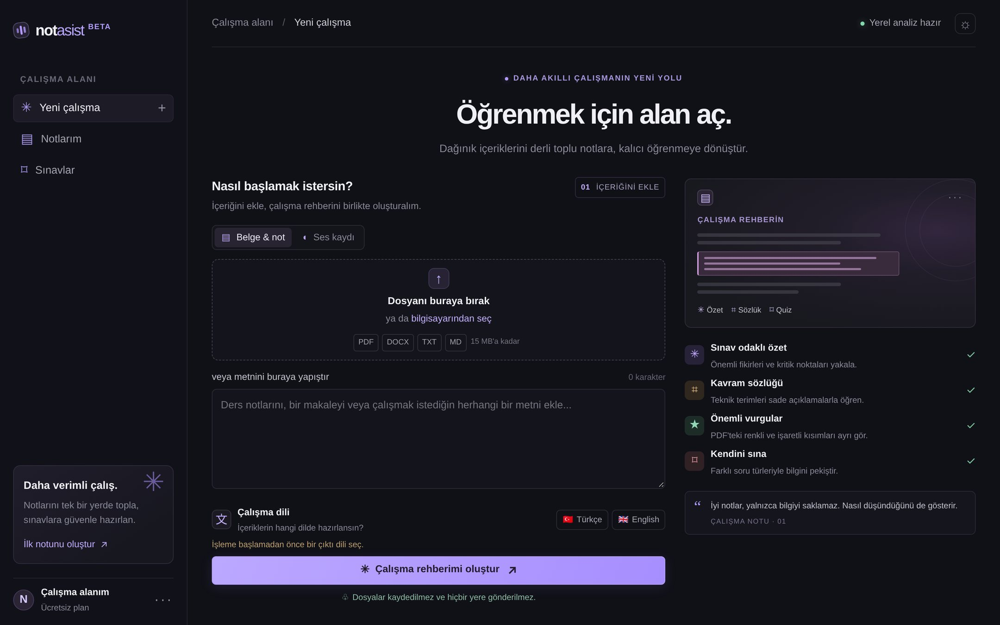
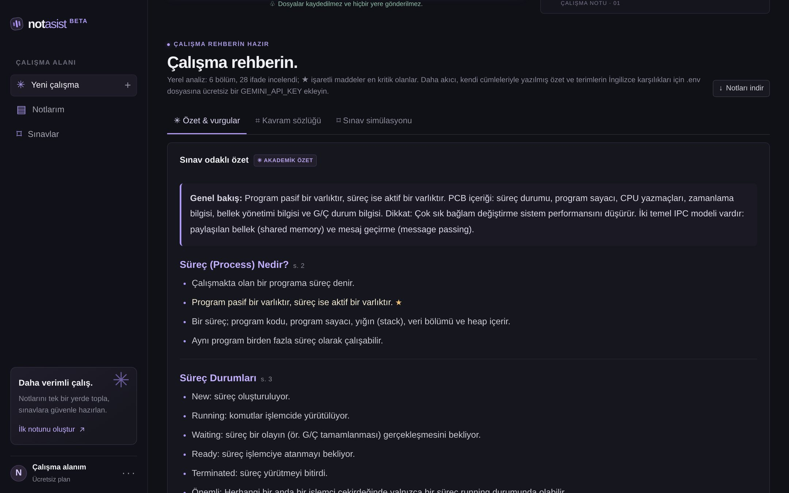
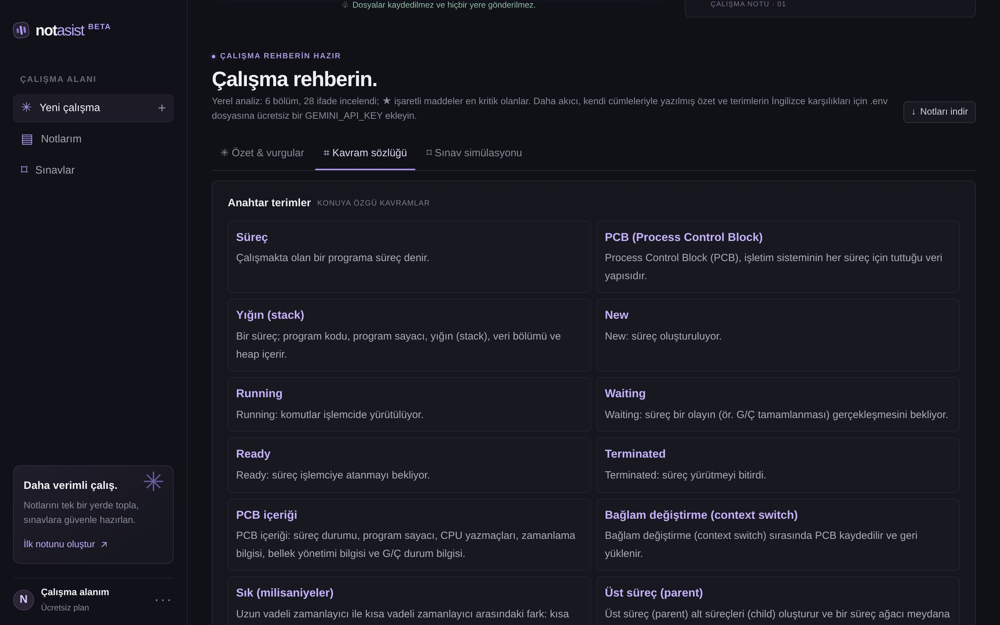
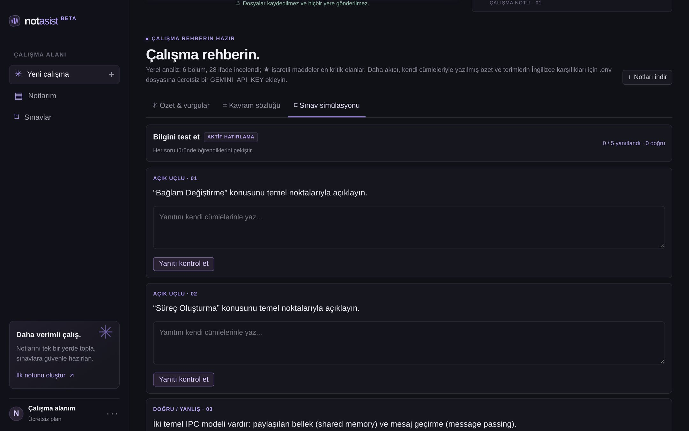
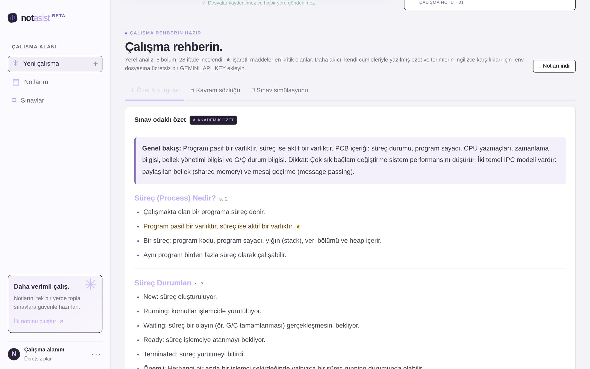
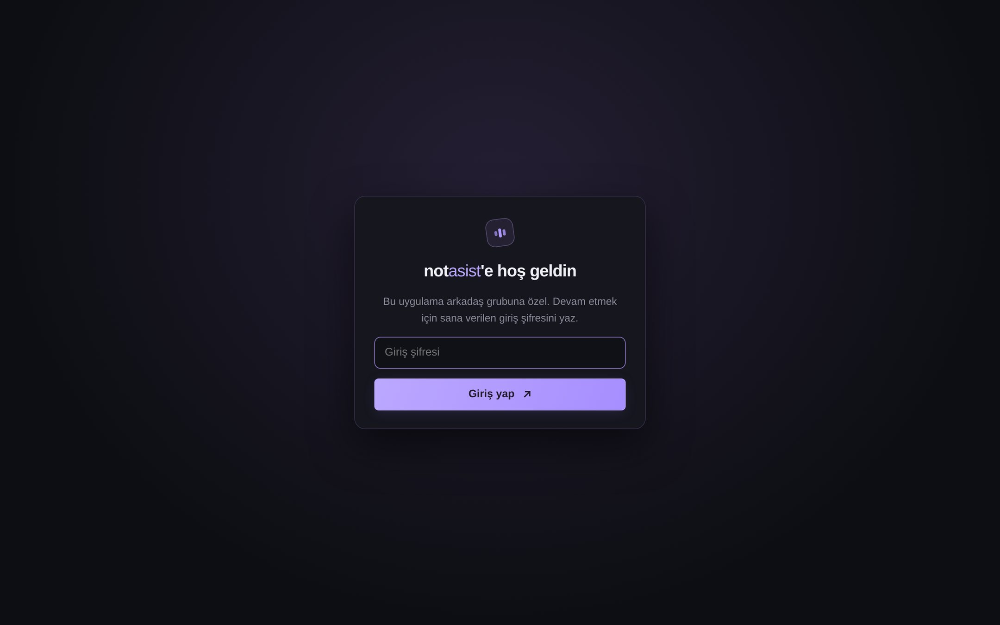
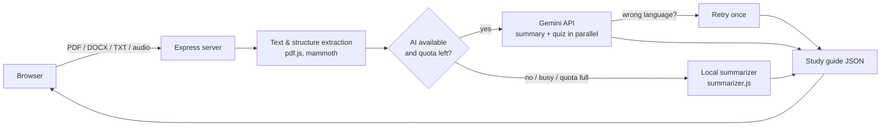

# Not Asist — AI Study Guide Generator

**Turn lecture slides, notes and recordings into exam-ready study guides.**
Upload a PDF, DOCX or text file (or record a lecture), choose Turkish or English, and get a structured summary, a glossary of key terms, likely exam points and a practice quiz.

> 🇹🇷 Not Asist; ders slaytlarını, notları ve ses kayıtlarını sınav odaklı çalışma rehberlerine dönüştüren bir web uygulamasıdır. Arayüz Türkçedir; çıktı Türkçe veya İngilizce olabilir.



## Features

- **Exam-focused summaries** – section-by-section study guide that follows the document's own headings/slides, with an overview paragraph and ★ markers on the most critical points.
- **Bilingual output** – Turkish or English. In Turkish mode, technical terms are followed by their English equivalents, e.g. *süreç (process)*.
- **Glossary** – key domain terms with definitions extracted from the source.
- **Highlight detection** – finds highlighted, underlined and coloured text in PDFs and lists it separately.
- **Practice quiz** – open-ended questions with model answers, true/false, and "select all that apply" questions with instant feedback.
- **Lecture audio** – upload a recording for AI transcription, or use live dictation in the browser (Chrome/Edge).
- **Works without an API key** – a built-in local summarizer analyses document structure and scores sentences, so the app is usable offline and never breaks when the AI quota runs out.
- **Shareable with a group** – optional access code, per-user daily AI limits, a shared daily cap and per-minute throttling, so a single free API key can be shared safely.
- Dark/light theme, responsive layout, Markdown export of the study guide.

| Summary | Glossary | Quiz |
|---|---|---|
|  |  |  |

| Light theme | Access screen |
|---|---|
|  |  |

*Screenshots show the offline (no API key) mode on a sample operating-systems lecture.*

## How it works



**AI mode (Gemini or OpenAI).** The extracted text is sent with two prompts in parallel: one produces the study guide (overview, sections, glossary, exam points), the other produces the quiz. Responses are requested as JSON and validated. If the model answers in the wrong language, the request is retried once with a stronger instruction. When Gemini is overloaded (HTTP 503) the server waits and retries, then falls back to a second model with its own quota; if everything fails, the local summarizer is used and the user sees a short explanation instead of an error.

**Local mode (`summarizer.js`).** Without any API, the app:

1. Rebuilds the document structure from PDF text positions and font sizes: slide titles, bullet points (including Wingdings/private-use bullet glyphs), repeated headers/footers removed, wrapped lines merged.
2. Scores every sentence/bullet with a TF-IDF-style weight plus cues for definitions, emphasis ("important", "dikkat"), comparisons, lists and cause–effect, with light Turkish suffix stemming.
3. Selects the most informative, non-redundant points per section and builds a glossary from definition patterns ("X is defined as…", "… denir", acronyms) and frequent terms.
4. Generates quiz questions, including false statements created by swapping key terms.

**Access control (`access.js`).** An optional access code (compared in constant time), per-browser and global daily AI limits that reset with Gemini's quota, a per-minute AI request budget, and IP rate limiting on login and API routes.

## Tech stack

- **Backend:** Node.js 22+, Express 5, Multer (in-memory uploads), pdf.js, mammoth
- **Frontend:** vanilla HTML, CSS and JavaScript (no framework, no build step)
- **AI:** Google Gemini API (free tier) or OpenAI API, both optional
- **Hosting:** Render (free web service)

## Getting started

```bash
git clone https://github.com/taliaerdg/not-asist.git
cd not-asist
npm install
cp .env.example .env   # optional: add GEMINI_API_KEY and ACCESS_CODE
npm start              # http://localhost:3000
```

A free Gemini API key can be created in [Google AI Studio](https://aistudio.google.com). Without a key the app runs in local mode.

### Configuration

| Variable | Default | Description |
|---|---|---|
| `GEMINI_API_KEY` | – | Enables Gemini for summaries, quizzes and audio transcription. |
| `GEMINI_MODEL` | `gemini-3.5-flash-lite` | Primary Gemini model. |
| `GEMINI_FALLBACK_MODEL` | `gemini-3.1-flash-lite` | Used when the primary model is overloaded or out of quota (`none` disables it). |
| `OPENAI_API_KEY` / `OPENAI_MODEL` | – / `gpt-4o-mini` | Alternative provider, used only if no Gemini key is set. |
| `ACCESS_CODE` | – | If set, users must enter this code before using the app. |
| `DAILY_AI_LIMIT_PER_USER` | `15` | AI analyses per browser per day (`0` = unlimited). |
| `DAILY_AI_LIMIT_TOTAL` | `200` | AI analyses per day for everyone combined. |
| `AI_REQUESTS_PER_MINUTE` | `8` | Shared per-minute AI request budget. |

### Deploying to Render

1. Push the repository to GitHub (`.env` is git-ignored).
2. On Render: **New → Web Service**, select the repository. Build command `npm install`, start command `npm start`, instance type **Free**.
3. Add `GEMINI_API_KEY` and `ACCESS_CODE` under **Environment Variables** and deploy.

Every push to `main` redeploys automatically. Free instances sleep after 15 minutes of inactivity, so the first request may take about a minute.

## Project structure

```
├── server.js        # Express app, routes, document extraction
├── ai.js            # Gemini / OpenAI calls, prompts, retries, language check
├── access.js        # access code, usage limits, rate limiting
├── summarizer.js    # local (offline) summarization engine
└── public/
    ├── index.html
    ├── styles.css
    └── app.js       # client: uploads, rendering, quiz, access screen
```

API endpoints: `GET /api/health`, `POST /api/verify-access`, `POST /api/analyze`, `POST /api/transcribe`.

## Privacy

Uploaded files are processed in memory and never stored. In AI mode, document text is sent to the configured provider; on Gemini's free tier, content may be used by Google to improve its products, so personal or confidential documents should not be uploaded. API keys stay on the server and are never sent to the browser.

## Possible improvements

- Persist study guides and quiz results per user
- Spaced-repetition flashcards generated from the glossary
- Export to PDF/Anki
- Usage counters stored in a database instead of memory
